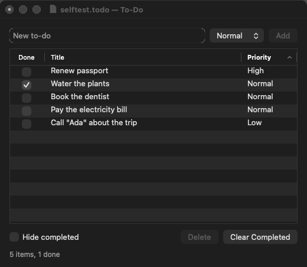

# loup-macos-todo — a to-do list manager in Loup

A native macOS to-do list: type a title, pick a priority, press Return (or
click **Add**). Items appear in a table with a **Done** check box, the title
and the priority. Tick items off in the table, double-click a title to rename
it, click a column header to sort by it (click it again to reverse the
order), hide completed items, delete the selected one or clear all completed
ones. Sorting reorders the list itself, so a saved file keeps that order; it
counts as an unsaved change only when the order actually changed. The status
line counts them ("5 items, 1 done"). **File ▸ Open… / Save / Save As…** read
and write the list as a small JSON file; the title bar shows the file's name
and icon, and the close button its "edited" dot while there are unsaved
changes. New, Open, closing the window and quitting ask before throwing away
unsaved changes.



Built on [loup-macos-appkit](https://github.com/myronccai/loup-macos-appkit),
the Loup library of proxy classes over AppKit.

## Getting started

### Requirements

- macOS on Apple silicon or Intel, with the Xcode Command Line Tools
  (`xcode-select --install`).
- A Loup toolchain of version newer than 1.27.0, with `loup`, `loup-build`,
  `loup-llvm`, `loup-test` and `loup-bootstrap` on `PATH`. This app needs
  fixes made after the 1.27.0 release ([Loup releases](https://github.com/code-craft-ai-company/loup-releases/releases)).
- If linking fails with `tapi error … unknown architecture`, point `SDKROOT`
  at an older SDK the linker understands, e.g.
  `export SDKROOT=/Library/Developer/CommandLineTools/SDKs/MacOSX26.5.sdk`.

### Get the code

The app depends on the appkit library by path
(`appkit = { path = "../loup-macos-appkit" }` in `loup-macos-todo.lppkg`), so
clone both repositories into the same directory:

```sh
git clone https://github.com/myronccai/loup-macos-appkit
git clone https://github.com/myronccai/loup-macos-todo
cd loup-macos-todo
```

### Build, run, test

From inside the `loup-macos-todo` checkout:

```sh
loup build                              # self-hosted toolchain → ./loup-macos-todo
loup-bootstrap build --target native    # or the Stage0 route
./loup-macos-todo                       # the app
loup test --strict src                  # the model and file-format tests
./loup-macos-todo --self-test [shot.png]     # drives the window, prints, quits

bash ../loup-macos-appkit/run_all.sh loup-macos-todo           # both drivers, tests, self-test vs selftest.out
bash ../loup-macos-appkit/run_all.sh --screenshots loup-macos-todo   # … and refresh screenshot.png
```

`run_all.sh` lives in the appkit repository and treats the directory holding
both checkouts as its workspace; with no app named it checks every
`loup-macos-*` app checked out there.

## The file format

```json
{
  "format": "loup-todo",
  "version": 1,
  "items": [
    {"title": "Renew passport", "done": true, "priority": "High"},
    {"title": "Call \"Ada\" about the trip", "done": false, "priority": "Low"}
  ]
}
```

Save proposes a `.todo` name; Open accepts `.todo` and `.json`. Titles are
JSON strings written by the app's own serializer: `"` and `\` are escaped,
tab / newline / return as `\t` `\n` `\r`, other control characters as
`\u00XX`. The reader takes any whitespace, any member order and every JSON
string escape (including `\uXXXX` surrogate pairs), and refuses anything
else with a message that names the line and column (shown in an alert).

## Structure

| File | Mode | What it is |
|---|---|---|
| `src/main.lphc` | `host.native` | The window, the handlers, the File menu, the unsaved-changes prompts, and the `--self-test` driver. |
| `src/todolist.loup` | `host.dual` | The model: `TodoItem`, `TodoList` (add, set done, rename, delete, clear completed, a stable sort either way that reports whether the order changed), the "hide completed" filter (`visibleIndexes`) and the status line. |
| `src/todofile.loup` | `host.dual` | The file format: `formatTodoFile`, `parseTodoFile`, `quoteJson`. |
| `src/todolist_test.lpscr`, `src/todofile_test.lpscr` | `host.scripted` | `loup test` suites for the model (including ascending / descending sorts) and the format (round trip, escaping of quotes, backslashes, tabs, newlines and control characters, error positions). |
| `selftest.out` | | The exact output of `./loup-macos-todo --self-test` (both drivers must print it). |
| `screenshot.png` | | Written by the self-test. |

The table shows the model through `g_rows`, the model indexes of the visible
items; every change goes to the model and then `refresh()` reloads the table
and updates the buttons, the status line and the window title (the title,
the file icon and the "edited" dot while there are unsaved changes). `TodoList`'s changing methods
are `modifier`s, so the window calls them inside `safe { }` blocks.

## The self-test

`--self-test` uses the window as a person would and prints what the controls
show after each step, read back from them (the status label and every table
row, the done boxes included):

1. types six items into the field (Add button and Return, priorities picked
   in the pop-up, one title with quotes) and checks a blank title is refused;
2. ticks two check boxes in the table, renames a title by editing its cell
   and pressing Return, and clicks the Priority header three times
   (ascending, descending, ascending again);
3. turns on "Hide completed", clicks a row and then Delete, turns the filter
   off;
4. saves with File ▸ Save (a canned `saveFile` answer, `.temp/selftest.todo`
   in the app folder) and prints the file;
5. clears completed items, File ▸ New (answers Don't Save), reopens the file
   with File ▸ Open… (a canned `openFile` answer), sorts it by priority again
   (already in that order: still not edited), then opens a broken file (an
   alert, list unchanged);
6. makes a change and cancels File ▸ New (once with Cancel, once with an
   alert that ends without a button press), Window ▸ Close, ⌘W and Quit;
   snapshots the window (when a path is given) and quits (Don't Save).

After each save and open it prints the title and the title bar's file (its
name only), and the window's edited state.

Every dialog gets a canned answer (`appkit.dialogs.setTestAnswers`), so no
real alert or panel appears, and the library keeps the window invisible and
out of the Dock. What the self-test does not do with real mouse events: a
row click (`TableView.clickRow`) and a header click (`TableView.clickHeader`)
take the steps AppKit takes for one through the table's own delegate and
action, because a never-activated app ignores synthetic mouse-downs. Titles
with tabs or newlines cannot be typed into the one-line field; the
`loup test` suites cover their escaping.

## appkit modules and controls used

| Module | Used for |
|---|---|
| `appkit.app` | `appInit`, `run`, `quit`, `after`, `isSelfTest`, `Window` (`setContent`, `setMinSize`, `setTitle`, `setRepresentedFilename`, `setDocumentEdited`, `onShouldClose`; `isDocumentEdited`, `representedFilename`, `isVisible`, `sendKey`, `snapshot` in the self-test), `onShouldQuit`, `Menu` and `insertMenu` (the File menu after the app menu), `menuBar` / `menuBarMenu` / `appMenu` / `windowMenu` and `MenuItem.perform` in the self-test |
| `appkit.controls` | `TextField` (placeholder, `onReturn`, `onChange`, `typeText`, `submit`), `PopUpButton` (priority, `choose`), `Button` (Add, Delete, Clear Completed), `Checkbox` (Hide completed), `Label` (status, in `systemColor(COLOR_SECONDARY_LABEL)`) |
| `appkit.layout` | `VStack`, `HStack` (`addExpanding`, `addSpacer`), `setMinSize` |
| `appkit.table` | `TableView`: `addCheckBoxColumn` + `onToggle` (done), `onEdit` (titles), `setColumnResizing`, `sizeColumnsToFit`, `onSort` (direction and header indicator), `setSortIndicator`, alternating rows; `clickRow`, `clickCheckBox`, `commitEdit`, `clickHeader`, `isChecked`, `cellText` in the self-test |
| `appkit.dialogs` | `openFile`, `saveFile`, `alert`, `beep`; `setTestAnswers` (button indexes, and `"-1"` for an alert that ends without a button press) / `testLog` in the self-test |

There is no raw Objective-C in the app: everything goes through the appkit
API.

## License

MIT; see [LICENSE](LICENSE). The app is built on
[loup-macos-appkit](https://github.com/myronccai/loup-macos-appkit), which is
also MIT-licensed; its README is the overview of the whole collection of
example apps.
